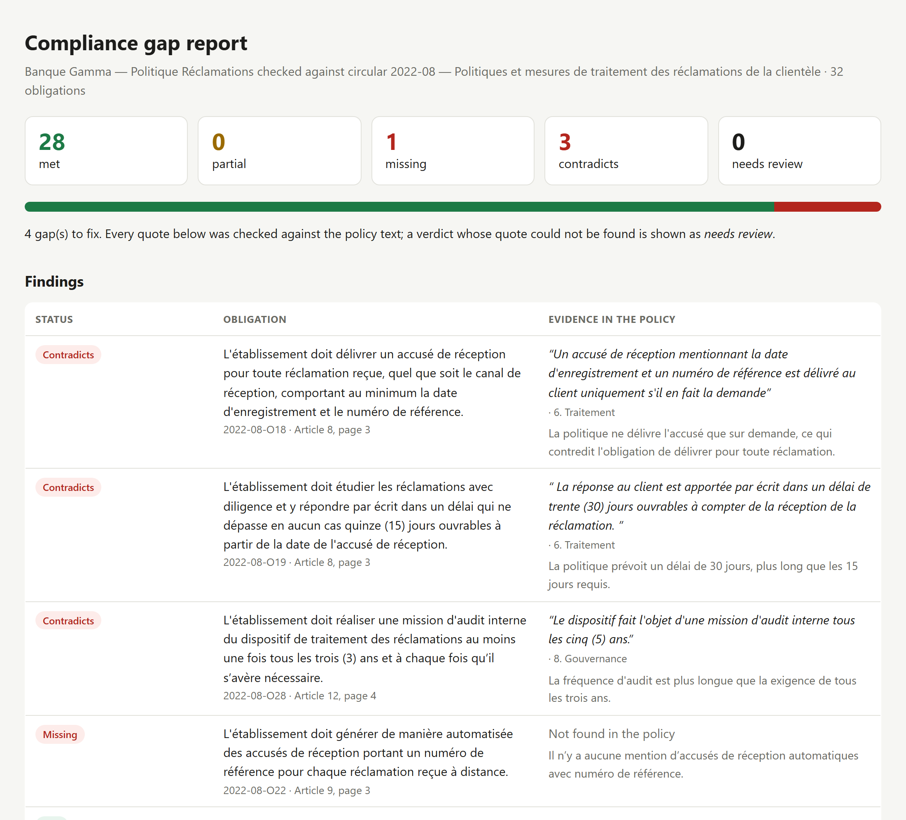
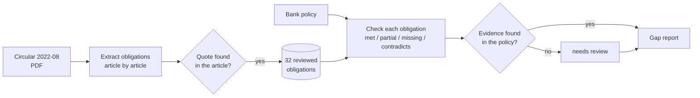
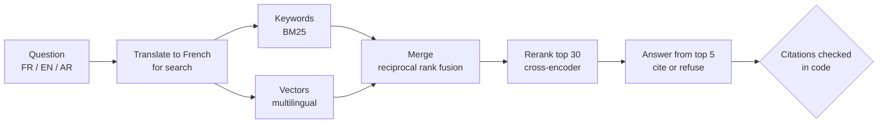

# Bank Compliance Assistant

[](https://github.com/benyounesthamer/bank-compliance-assistant/actions/workflows/ci.yml)


An AI assistant for Tunisian banking regulation, built on 22 official circulars of the Central Bank of Tunisia. It does two jobs:

1. **Compliance gap analysis.** Give it a bank's internal policy. It checks the policy against every obligation of a circular and reports what is met, partial, missing or contradicted, quoting the policy's own words as evidence.
2. **Cited answers.** Ask a question in French, English or Arabic. It answers from the circulars only, cites the circular, article and page, and says so when the circulars do not contain the answer.



*Gap report for a fictional bank's complaint-handling policy, checked against circular 2022-08.*

## Compliance gap analysis



**1. Obligations, extracted once and reviewed.** A model reads each article and splits it into single, checkable obligations, each with a word-for-word quote. Code keeps only those whose quote is really in the article. The list is then reviewed by hand and saved ([data/obligations/2022-08.json](data/obligations/2022-08.json)), so every analysis checks against the same 32 obligations. The review is recorded in the file: 3 items removed (a scope statement and two reporting templates), Article 8 recovered after the first extraction silently returned nothing, and 5 obligations reworded so they make sense without the rest of the circular.

**2. Every verdict must show its evidence.** For each obligation the model returns a status and quotes the policy. Code checks each quote against the policy text. A verdict whose quote is not in the policy becomes **needs review**, so the report never attributes words to a bank that it did not write. "Stricter than required" counts as met (10 days for a 15-day rule).

**3. Measured on policies with known gaps.** Four fictional policies were written with an answer key for all 32 obligations: one fully compliant, one with 10 obligations left out, one with 4 contradictions (30 days instead of 15, audit every 5 years instead of 3, acknowledgement only on request, no automatic acknowledgement), and one in English with a trap ("15 calendar days" is stricter than 15 working days).

| Run | Real gaps found | False gaps | Exact status |
|---|---|---|---|
| First run | 16 of 17 | 6 of 111 compliant obligations | 119 of 128 |
| After fixing the obligation wording | **17 of 17** | **2 of 111** | **125 of 128** |

Model: `gpt-oss-20b` (Groq), one run per policy. Full results and every disagreement: [eval/gaps.md](eval/gaps.md).

Read these numbers with their limits: the second run comes after I reworded obligations that pointed to other articles, a fix made after seeing the first run on the same four policies. Results also vary between runs: the same policy analysed again through the web demo flagged 6 gaps instead of 4. The remaining errors are real: the checker called "15 calendar days" a contradiction (it is stricter), and once said "missing" where the policy explicitly refuses automatic acknowledgements.

## Cited answers



Retrieval, measured on 42 questions in three languages (no API needed):

| Search | Right article first | In top 5 | First, FR | First, EN | First, AR |
|---|---|---|---|---|---|
| Keywords (BM25) | 55% | 74% | 65% | 25% | 50% |
| Vectors | 67% | 81% | 65% | 62% | 75% |
| Keywords + vectors | 67% | 90% | 81% | 25% | 62% |
| **+ reranker** | **86%** | **95%** | 85% | 88% | 88% |

Each layer earns its place: keywords are strong on exact French terms, vectors handle other languages, and the reranker, which reads question and passage together, gives the largest gain. Every cited passage is checked in code: an answer citing a passage the model was not given becomes a refusal.

End-to-end answers on 48 questions (answers by `gpt-oss-20b`, judged by `qwen3.8-27b` against reference answers):

| Questions | Correct | Cites a right article | Refused |
|---|---|---|---|
| French (26) | 77% | 81% | 19% |
| English (8) | 75% | 75% | 25% |
| Arabic (8) | 62% | 88% | 12% |
| **All answerable (42)** | **74%** | 81% | 19% |
| **Unanswerable (6)** | **5 of 6 refused** | – | – |

The main weakness is over-caution, not search: the right article was among the retrieved passages for 98% of questions, yet 8 of the 11 errors are refusals. One error is a real mix-up between two columns of a rate table, and two are partly due to vague reference answers. Every answer and the judge's reason are in [eval/answers.md](eval/answers.md). The next improvement is the answer prompt, measured on this same set.

## The documents

22 circulars from 2017 to 2025, downloaded from [bct.gov.tn](https://www.bct.gov.tn): anti-money laundering, complaint handling, provisioning, IFRS adoption, consolidated supervision, credit bureaus, crowdfunding, banking conditions, agricultural credit scales. Several exist in both French and Arabic. The PDFs are not stored in this repository; `bankrag download` fetches them from the official site.

## Quick start

```bash
python -m venv .venv
.venv/Scripts/activate              # Linux/macOS: source .venv/bin/activate
pip install -e ".[dev]"
cp .env.example .env                # then add a Groq or Gemini API key

bankrag download                    # the 22 PDFs from bct.gov.tn (5 MB)
bankrag index                       # parse, chunk, embed (downloads ~0.8 GB of models once)

bankrag gaps eval/policies/gamma_contradictions.md      # writes gap_report.html
bankrag ask "Quel est le délai maximal pour répondre à une réclamation ?"
```

Web demo (both tools) and API:

```bash
uvicorn bankrag.api:app --port 8000     # open http://127.0.0.1:8000
```

| Endpoint | Purpose |
|---|---|
| `POST /gaps` `{"policy": "..."}` | Gap analysis against circular 2022-08 |
| `POST /ask` `{"question": "..."}` | Answer with sources |
| `GET /search?q=...&mode=bm25` | Raw retrieval, any of the four modes |
| `GET /examples` | The four test policies |

## Evaluation

```bash
python eval/eval_gaps.py         # gap analysis on the 4 test policies
python eval/eval_retrieval.py    # the four search modes, no API key needed
python eval/eval_answers.py      # end-to-end answers, judged
pytest                           # unit tests, no models or key needed
```

All evaluations are resumable: on a free API tier they stop when the daily quota runs out and continue on the next run.

## Project layout

```
src/bankrag/
  obligations.py   circular -> atomic obligations with verified quotes
  gaps.py          policy check, evidence verification
  gap_report.py    HTML and Markdown gap reports
  ingest.py        PDF -> chunks with circular number, title, date, article, page
  text.py          normalisation for French, Arabic, English
  retrieve.py      BM25, vectors, fusion, reranking
  answer.py        cited answers, refusals, query translation
  api.py           FastAPI + demo page (static/index.html)
data/obligations/  reviewed obligation lists
eval/              questions, test policies with answer keys, evaluation scripts, results
```

## Limitations

- **Gap analysis covers one circular so far** (2022-08, complaint handling). Adding a circular means extracting and reviewing its obligations.
- **The test policies and questions were written by me,** so they are cleaner than real bank documents and real users' questions.
- **The checker is a language model:** it makes mistakes, which is why every verdict carries its evidence and the evaluation lists every disagreement.
- **Data quality:** one Arabic PDF (circular 2018-11) uses a broken font, so its text is partly garbled.
- **No tracking of repeals:** when circulars disagree, answers prefer the most recent one, but amendments are not modelled.

## Disclaimer

Not legal advice. The example policies are fictional. Always check the official texts on [bct.gov.tn](https://www.bct.gov.tn).
